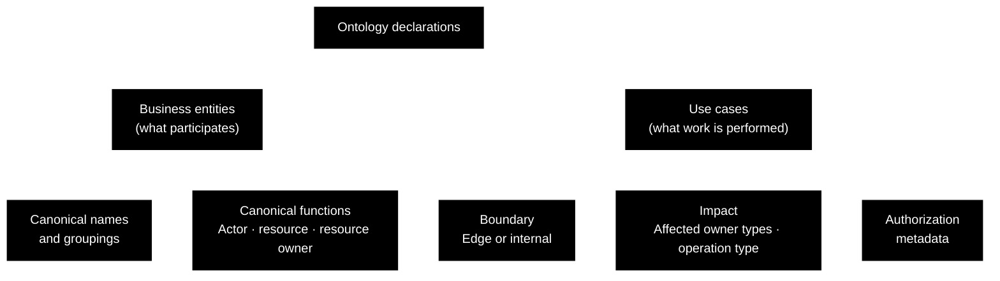
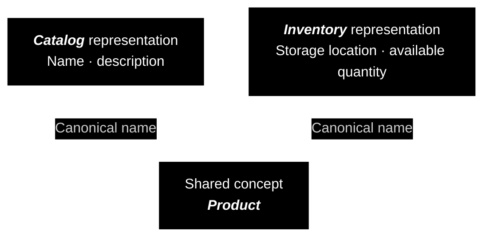
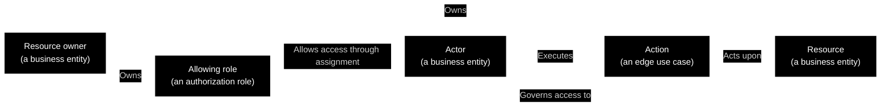

CAE Concept

---

 

### Clean Ontology

Many information-system operations can be understood as an actor executing an action upon a resource. Clean Ontology adopts this relationship as a foundation for describing business entities, application capabilities, and how they relate to each other.

This shared vocabulary can also express ownership-based access: resources belong to a resource owner, which also owns authorization roles defining access to those resources. Assigning an allowing role to an actor permits the actions covered by that role on resources belonging to the role's owner.

For example, a user may edit a document belonging to a workspace. Whether that user is allowed to edit it depends on the permissions assigned to the user for that workspace.

 

#### Actors, Actions, and Resources

Three participants describe the work being requested:

- **Actor:** the user or system initiating or performing the work.
- **Action:** the capability an actor requests to perform work upon a resource.
- **Resource:** the target upon which the action operates.

For example, when a user edits a document, the user is the actor, editing is the action, and the document is the resource. The application carries out that action through a **[use case](https://github.com/clean-arch-enablers-project/clean-use-cases/blob/feature/hello-world/concept/README.md)**: a workflow that performs the work required to achieve the requested outcome.

Clean Ontology describes two complementary subjects: **business entities** (the concepts participating in the domain) and **[use cases](https://github.com/clean-arch-enablers-project/clean-use-cases/blob/feature/hello-world/concept/README.md)** (the capabilities that perform work involving them). Entity declarations identify what is represented and its ontological functions. Use-case declarations identify the capability's audience, affected resource-owner types, and operation characteristics.

 

#### Business Entity Declarations

For a business entity's representation, the declaration identifies **which domain concept it represents**, through canonical names, and **how it participates**, through the actor, resource, and resource-owner functions. A representation combining several concepts can also declare that grouping.

Actor, resource, and resource owner are **ontological functions** of business entities: the ways they participate in relationships and actions within the domain, the area of activity the software serves.

A **domain concept** names something the system models, such as a user, document, or workspace. Here, **business entity** and **domain entity** refer to that same idea. The domain concept's **ontological functions** describe how it participates in the relationships being modeled: a user can act (be an _actor_), a document can be acted upon (_be a resource_), and a workspace can own that document (_be a resource owner_).

The actor, resource, and resource-owner functions can overlap. A user can act upon documents, own resources, and itself be a resource when an administrative action updates it. A workspace can own documents while being the resource targeted by another action.

Taken together, business entities and their ontological functions describe what is being modeled and how it participates as an actor, resource, or resource owner. A single entity can fulfill several of these functions, depending on the relationship or action being described.

 

##### Subdomain Representations and Canonical Names

Different parts of a system may represent the same domain concept for different purposes. A **subdomain** is a part of the domain concerned with a set of responsibilities. Its **representation** is the local model of a concept used to fulfill those responsibilities.

For example, imagine an online store that uses a concept called ***Product*** to represent the items it sells. A ***Catalog*** subdomain, responsible for presenting items to shoppers, represents a product through information such as its name and description. An ***Inventory*** subdomain, responsible for managing stock, represents the same product through information such as its storage location and available quantity. The ***Catalog*** and ***Inventory*** representations refer to the same domain concept, but each contains the fields, relationships, and behavior needed for its own responsibilities.

A **canonical name** identifies that shared concept. Both representations can declare the canonical name ***Product*** even when their local names and structures differ. Their ontological functions declare how they participate in their respective subdomains.

Sharing a canonical concept does not require sharing a software type or database structure. The declaration makes their common meaning explicit across those implementation differences.

A **grouped representation** brings several canonical concepts into one local model. An ***Account Overview*** might combine ***Account*** and ***Workspace*** information while declaring both concepts and preserving their separate meanings.

 

##### Ownership and Authorization Roles

A **resource owner** is a type of business entity to which resources belong. It also provides the ownership boundary for authorization roles: permissions associated with one owner apply only to that owner's resources.

An **authorization role** associates permissions with an owner. An **assignment** connects that role to an actor. An allowing role grants an assigned actor permission to execute the actions it allows within that ownership boundary.

For example, a role owned by ***Workspace A*** may allow ***Edit Document***. Assigning it to an actor permits that action on documents belonging to ***Workspace A***; it does not grant the same access to documents belonging to ***Workspace B***.

The relationships answer distinct questions: **who acts**, **what action is requested**, **what resource is targeted**, **to whom it belongs**, and **which assigned role allows access**.

 

#### Use-Case Declarations

Business entity declarations describe the participants. Use-case declarations describe the work: who it serves, which owners' resources it concerns, and whether it reads or changes information.

##### Edge and Internal Capabilities

A [use case](https://github.com/clean-arch-enablers-project/clean-use-cases/blob/feature/hello-world/concept/README.md) serving an end user or another external actor is called an **edge [use case](https://github.com/clean-arch-enablers-project/clean-use-cases/blob/feature/hello-world/concept/README.md)**. It represents the action offered at the application's boundary, accessible through an entry point such as an API or command.

Carrying out that work may also require the system to coordinate its own internal operations. Those operations have a different audience and purpose: keeping the system functioning and its information consistent. Workflows developed for these mechanics are called **internal [use cases](https://github.com/clean-arch-enablers-project/clean-use-cases/blob/feature/hello-world/concept/README.md)**.

One use for internal [use cases](https://github.com/clean-arch-enablers-project/clean-use-cases/blob/feature/hello-world/concept/README.md) is synchronizing distributed subdomains. In **event-driven architecture (EDA)**, one part of the system publishes an event describing something that happened, and other parts react through their own internal workflows. An internal [use case](https://github.com/clean-arch-enablers-project/clean-use-cases/blob/feature/hello-world/concept/README.md) can update a subdomain's local representation in response to such an event, without requiring the originating subdomain to call or understand that synchronization logic.

For example, an external actor can request the edge action ***Create Account***. A resulting event can trigger an internal ***Synchronize Membership*** [use case](https://github.com/clean-arch-enablers-project/clean-use-cases/blob/feature/hello-world/concept/README.md) in another subdomain. The first capability serves the actor's requested outcome; the second keeps the distributed system's local information aligned. The subdomains coordinate through an agreed event contract rather than depending on each other's internal implementation.

This connects to the **inner flow** and **outer flow** described in [Clean Execution Context](https://github.com/clean-arch-enablers-project/clean-execution-context/blob/feature/hello-world/concept/README.md#execution-identity-versus-flow-identity). Each [use case](https://github.com/clean-arch-enablers-project/clean-use-cases/blob/feature/hello-world/concept/README.md) is an inner flow within its application: both ***Create Account*** and ***Synchronize Membership*** have their own execution metadata and outcome. The outer flow describes the broader process connecting their work across the system.

The initiating edge action often gives that end-to-end process its purpose and can supply its name. In this example, ***Create Account*** can name the outer flow as well as the initiating application's inner flow. The [execution context](https://github.com/clean-arch-enablers-project/clean-execution-context/blob/feature/hello-world/concept/README.md) carries that outer-flow identity and the execution instance's correlation ID through the participating work, including event-driven continuation. ***Synchronize Membership*** retains its own inner-flow identity while participating in the outer ***Create Account*** process.

Edge and internal therefore describe a [use case](https://github.com/clean-arch-enablers-project/clean-use-cases/blob/feature/hello-world/concept/README.md)'s audience and purpose; inner and outer describe the local workflow and the broader process it participates in. An edge [use case](https://github.com/clean-arch-enablers-project/clean-use-cases/blob/feature/hello-world/concept/README.md) is still an inner flow within its application, even when it initiates and names the outer flow.

 

##### Declared Characteristics

Within Clean Ontology, use-case declarations describe who a capability serves, whose resources it affects, what kind of operation it performs, and which permissions it requires:

- **Boundary:** whether the capability is an edge or internal [use case](https://github.com/clean-arch-enablers-project/clean-use-cases/blob/feature/hello-world/concept/README.md).
- **Affected resource-owner types:** the categories of owners whose resources it concerns, such as ***Workspace***.
- **Operation type:** whether it reads information or manipulates it through creation, modification, or deletion.
- **Authorization requirements:** the scope requirements or action identity used for permission decisions.

The affected resource-owner declaration identifies which kinds of owners the capability concerns. For example, an application may contain many workspaces, each owning its own documents. Declaring ***Workspace*** as an affected owner type says that the capability concerns workspace-owned resources, without choosing a specific workspace.

An **owner identifier** distinguishes a particular owner, such as one workspace, from others of the same type. The owner type names the category; the identifier names the specific owner involved in an execution.

An **action identifier** gives an edge capability a stable reference in the permission system. Policies can refer to that action independently of local implementation names. For example, ***View Document*** can be declared read-only and ***Edit Document*** as manipulation, both affecting workspace-owned resources.

 

#### Declarations and Their Consumers

Ontology declarations make the relationships available to documentation and tooling. Canonical names let tools connect representations across subdomains. Capability declarations let them identify the available actions, their intended audience, the owners they concern, and whether they read or change information.

Permission tooling can also consume these declarations to register actions and establish standard roles, such as full-access or read-only roles for resource owners. These are practical uses of the vocabulary; the ontology itself defines the meaning that makes such automation possible.

Automatic authorization, including scope-based and role-based evaluation, belongs to **[Clean Autofeatures](https://github.com/clean-arch-enablers-project/clean-autofeatures/blob/feature/hello-world/concept/README.md)**. The [Clean Autofeatures](https://github.com/clean-arch-enablers-project/clean-autofeatures/blob/feature/hello-world/concept/README.md) concept explains how declared authorization requirements are interpreted and enforced. Here, the focus is on describing the participants, capabilities, and relationships those mechanisms use.

 

#### A Shared Vocabulary for Relationships and Access

Clean Ontology connects actors, actions, resources, resource owners, and authorization roles through explicit relationships. Canonical names preserve shared domain meaning across subdomain representations, while capability declarations describe the work offered by the application.

These declarations are **semantic metadata**: information that readers and tools can inspect and interpret. Documentation and permission components consume the ontology metadata to document the system, provision permissions, and evaluate access. Ontology declarations describe the meaning; the consuming components implement the behavior.

 
 

---

clean software, made easy.

